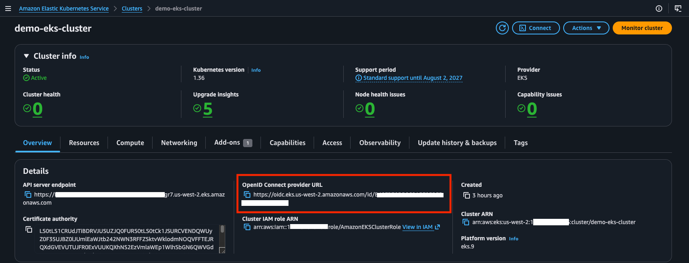
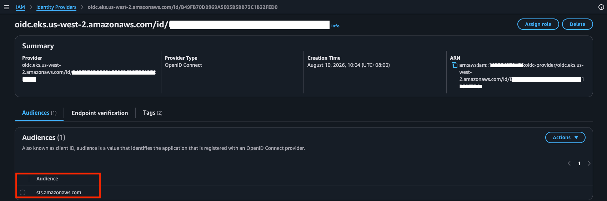

## Investigating AWS load balancer controller CrashLoopBackOff

Follow the guide below for installing and using AWS load balancer controller
https://docs.aws.amazon.com/eks/latest/userguide/lbc-helm.html


However hit into this issue:

```bash
kubectl get pods -A
NAMESPACE      NAME                                                     READY   STATUS             RESTARTS        AGE
kube-system    aws-load-balancer-controller-7f8c9975ff-d5xxq            0/1     CrashLoopBackOff   3 (25s ago)   82s
kube-system    aws-load-balancer-controller-7f8c9975ff-gqspt            0/1     CrashLoopBackOff   3 (23s ago)   82s
```

```bash
kubectl logs -n kube-system deployment/aws-load-balancer-controller --tail=50
  
Found 2 pods, using pod/aws-load-balancer-controller-7f8c9975ff-d5xxq
{"level":"info","ts":"2026-07-26T07:23:09Z","msg":"version","GitVersion":"v2.14.0","GitCommit":"d847890e67b4c3a78f230bd7f7caf2bfcab01df1","BuildDate":"2025-10-02T19:02:22+0000"}
{"level":"error","ts":"2026-07-26T07:23:14Z","logger":"setup","msg":"unable to initialize AWS cloud","error":"failed to get VPC ID: failed to fetch VPC ID from instance metadata: error in fetching vpc id through ec2 metadata: get mac metadata: operation error ec2imds: GetMetadata, canceled, context deadline exceeded"}
```

The reason is because the IMDS hop-count limit is set to 1 which does not allow the AWS load balancer controller pods to get information about the VPC ID from the instance meta-data. One solution is to change the hop count limit

```bash
aws ec2 modify-instance-metadata-options \
  --instance-id i-079065e855dad1986 \
  --http-put-response-hop-limit 2 
```

Alternatively when you install the Helm chart for the load-balancer controller, pass in the VPC ID of the VPC where the EKS cluster is set up so that there is no need query IMDS for the vpc-id

```bash
helm install aws-load-balancer-controller eks/aws-load-balancer-controller \
  -n kube-system \
  --set clusterName=<CLUSTER-NAME> \
  --set serviceAccount.create=false \
  --set serviceAccount.name=aws-load-balancer-controller \
	--set region=<AWS-REGION> \
	--set vpcId=<VPC-ID>> \	
  --version 1.14.0
```

## Considerations for IAM role used by aws-load-balancer-controller
eksctl will use Cloudformation to create a role like *eksctl-<cluster-name>-addon-iamserviceaccou-Role1-<random-suffix>* if you follow instructions at https://docs.aws.amazon.com/eks/latest/userguide/lbc-helm.html and this means if you have 2 clusters with the same name eksctl may throw an error message like the below

```bash
eksctl create iamserviceaccount \
    --cluster=demo-eks-cluster \
    --namespace=kube-system \
    --name=aws-load-balancer-controller \
    --attach-policy-arn=arn:aws:iam::<ACCOUNT-D>:policy/AWSLoadBalancerControllerIAMPolicy \
    --override-existing-serviceaccounts \
    --region us-west-2 \
    --approve	

2026-08-10 02:08:42 [ℹ]  1 existing iamserviceaccount(s) (kube-system/aws-load-balancer-controller) will be excluded
2026-08-10 02:08:42 [ℹ]  1 iamserviceaccount (kube-system/aws-load-balancer-controller) was excluded (based on the include/exclude rules)
2026-08-10 02:08:42 [!]  metadata of serviceaccounts that exist in Kubernetes will be updated, as --override-existing-serviceaccounts was set
2026-08-10 02:08:42 [ℹ]  no tasks
```

This is due to an IAM role created under Cloudformation for a cluster of the same name. It happens even though you do not have a service-account named *aws-load-balancer-controller* in the kube-system namespace

The solution? Use a different cluster name, or try to create the IAM role manually with the trust policy set to trust the OIDC endpoint of the new cluster, and create and annotate the service account


## How to set the IAM role for aws-load-balancer-controller manually for use with IRSA

### Step 1 - create the IAM policy for aws-load-balancer-controller (done once for each AWS account)
Following instructions from https://docs.aws.amazon.com/eks/latest/userguide/lbc-helm.html , 

```bash
curl -O https://raw.githubusercontent.com/kubernetes-sigs/aws-load-balancer-controller/v2.14.1/docs/install/iam_policy.json

aws iam create-policy \
    --policy-name AWSLoadBalancerControllerIAMPolicy \
    --policy-document file://iam_policy.json
```
This will create an IAM policy *AWSLoadBalancerControllerIAMPolicy*

### Step 2 - set up OIDC authentication for the EKS cluster

You can use eksctl as below

```bash
eksctl utils associate-iam-oidc-provider --region=<AWS-REGION> --cluster=<CLUSTER-NAME> --approve
```

or use the portal GUI:

Copy the OIDC URL from the EKS cluster



Create an Identity Provider for the EKS OIDC like the below




### Step 3 - Create an IAM role to use the policy in Step 1, and set the trust policy to trust the OIDC provider from the EKS cluster


### Step 4 - Create the service account in kube-system namespace to be used by aws-load-balancer-controller pods, making sure to annotate it with the ARN of the role in step 3

