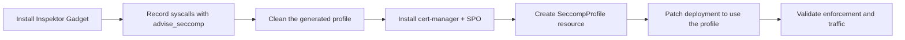

# Building and Enforcing a Seccomp Profile with Inspektor Gadget on AWS EKS (Bottlerocket)

## Overview

This document records a test in which **Inspektor Gadget** was used to observe the system calls (syscalls) an `nginx` container makes to the Linux kernel. The observed syscalls were turned into a **seccomp profile**, which was then installed on every node with the **Security Profiles Operator (SPO)** and enforced on the `nginx` deployment.

The aim is a least-privilege profile: the container may make only the syscalls it actually needs, and the kernel rejects everything else.



## Test environment

| Component | Version / value |
|---|---|
| Cluster | AWS EKS |
| Kubernetes | Control plane v1.36.4, kubelet v1.36.2 |
| Node OS | Bottlerocket OS 1.67.0 (`aws-k8s-1.36`), kernel 6.18.51, 2 nodes |
| Container runtime | containerd 2.2.9 (Bottlerocket build) |
| Inspektor Gadget | v0.57.0 (client and server) |
| krew | 0.5.0 (installed with Homebrew) |
| cert-manager | v1.21.3 |
| Security Profiles Operator | v1.1.1 |
| Test workload | `nginx` deployment, 1 replica, `default` namespace |

---

## 1. What is seccomp?

**Seccomp** (secure computing mode) is a Linux kernel feature that limits which syscalls a process may make. Every action a container takes, such as opening a file, accepting a network connection or starting a process, ends up as a syscall to the shared host kernel. The kernel exposes over 300 syscalls, and a typical application uses only a fraction of them.

A seccomp profile is an allow-list (or deny-list) of syscalls that the kernel enforces with a BPF filter attached to the process. Restricting syscalls:

- **reduces the kernel attack surface** available to a compromised container
- **blocks many container-escape and privilege-escalation techniques** that depend on rarely used syscalls (for example `unshare`, `mount`, `ptrace`, `bpf`, `keyctl`)

A profile is a JSON document with three main parts:

```json
{
  "defaultAction": "SCMP_ACT_ERRNO",
  "architectures": ["SCMP_ARCH_X86_64"],
  "syscalls": [
    { "names": ["read", "write", "openat"], "action": "SCMP_ACT_ALLOW" }
  ]
}
```

- `defaultAction` is what happens to any syscall **not** listed.
- `architectures` lists the CPU architectures the filter applies to.
- `syscalls` lists syscall names and the action to take for each.

Common actions:

| Action | Effect |
|---|---|
| `SCMP_ACT_ALLOW` | The syscall is allowed |
| `SCMP_ACT_ERRNO` | The syscall fails with an error (EPERM by default); the process keeps running |
| `SCMP_ACT_LOG` | The syscall is allowed but logged; useful for testing a profile |
| `SCMP_ACT_KILL_PROCESS` | The process is killed |

Kubernetes sets seccomp per pod or per container with `securityContext.seccompProfile.type`:

| Type | Meaning |
|---|---|
| `Unconfined` | No seccomp filter |
| `RuntimeDefault` | The container runtime's generic default profile, which blocks a set of dangerous syscalls |
| `Localhost` | A custom profile loaded from the node's `/var/lib/kubelet/seccomp/` directory |

This test builds a **`Localhost`** profile tailored to `nginx`, which is stricter than `RuntimeDefault` because it allows only the syscalls nginx was seen to use.

---

## 2. Installing Inspektor Gadget on EKS (Bottlerocket)

Inspektor Gadget is a set of eBPF-based tools ("gadgets") for inspecting Kubernetes workloads. It has two parts:

- **`kubectl gadget`**, a kubectl plugin on the workstation, installed through krew
- **a DaemonSet** in the `gadget` namespace that runs on every node and loads the eBPF programs into the kernel

### 2.1 Install krew and the gadget plugin (workstation)

```bash
brew install krew

# Add krew's plugin directory to PATH (add this line to ~/.zshrc to make it permanent)
export PATH="${KREW_ROOT:-$HOME/.krew}/bin:$PATH"

kubectl krew update
kubectl krew install gadget
```

> Homebrew puts the `krew` binary itself on `PATH`, but plugins are installed under `~/.krew/bin`. Without the `PATH` entry above, `kubectl gadget` fails with `unknown command "gadget" for "kubectl"`.

### 2.2 Deploy Inspektor Gadget to the cluster

```bash
kubectl gadget deploy
```

### 2.3 Verify

```bash
kubectl gadget version
kubectl get ds,pods -n gadget -o wide
```

Result:

```
Client version: v0.57.0
Server version: v0.57.0

NAME                    DESIRED   CURRENT   READY   UP-TO-DATE   AVAILABLE   NODE SELECTOR
daemonset.apps/gadget   2         2         2       2            2           kubernetes.io/os=linux

NAME               READY   STATUS    NODE
pod/gadget-fdpxf   1/1     Running   node-1
pod/gadget-vv4hr   1/1     Running   node-2
```

### 2.4 Bottlerocket considerations

Bottlerocket is a minimal, container-only OS: there is no shell, package manager or SSH on the host, the root filesystem is read-only, and SELinux is enforcing. Inspektor Gadget works on it without host changes because:

- **No packages are needed on the host.** Gadgets use eBPF CO-RE (compile once, run everywhere) and the kernel's built-in BTF type information, so kernel headers are not required.
- **Everything runs in the DaemonSet.** The gadget pod is granted the capabilities it needs (`SYS_ADMIN`, `SYS_PTRACE`, `SYS_RESOURCE`, `IPC_LOCK`, `NET_ADMIN`, `NET_RAW`, `SYSLOG`, `DAC_READ_SEARCH`) rather than full `privileged` mode.
- **SELinux is handled with the `spc_t` label.** The DaemonSet runs with `seLinuxOptions.type: spc_t` (super-privileged container), which Bottlerocket's SELinux policy allows to access host resources.
- **Host paths are mounted into the pod** (`/proc`, `/run`, `/sys/fs/bpf`, `/sys/fs/cgroup`, `/sys/kernel/debug` and others) so the gadget can attach eBPF programs and map events to Kubernetes pods and containers.

---

## 3. Recording syscalls and generating a profile

### 3.1 Deploy the test workload

```bash
kubectl create deployment nginx --image=nginx --replicas=1
kubectl get pods -l app=nginx
```

### 3.2 How `advise_seccomp` works

The `advise_seccomp` gadget attaches an eBPF program to the kernel's syscall entry point and records every syscall made by the selected containers. When the gadget stops, it prints one seccomp profile per container, allowing exactly the syscalls it observed.

Two rules matter when recording:

1. **Start the gadget before the container starts.** A container makes many syscalls during startup (loading libraries, dropping privileges, binding sockets). If the gadget starts after the container, those syscalls are missed, and the profile will stop the container from starting.
2. **Exercise the application while recording.** Only code paths that run during the recording end up in the profile.

### 3.3 Run the recording

**Terminal 1** starts the gadget, filtered by label, for 120 seconds:

```bash
kubectl gadget run advise_seccomp:latest \
  -n default \
  -l app=nginx \
  -t 120 > mynginx-seccomp-profile.json
```

**Terminal 2**, after the gadget is running, restarts nginx so that startup is recorded, then sends traffic:

```bash
kubectl rollout restart deployment/nginx
kubectl rollout status deployment/nginx

kubectl port-forward deploy/nginx 8080:80 &
for i in $(seq 1 20); do
  curl -s -o /dev/null -w "%{http_code} " localhost:8080           # 200: serve a page
  curl -s -o /dev/null -w "%{http_code} " localhost:8080/missing   # 404: error path
done
```

All 20 requests to each URL returned the expected `200` and `404`. The gadget wrote the profile when its 120-second timeout ended.

> **Pitfall: filter by label, not pod name.** The first attempt used `--podname nginx-68fd85dc6c-jb6st` and captured nothing. `kubectl rollout restart` replaces the pod, and the new pod has a different name, so the gadget was watching a pod that no longer existed. Labels (`-l app=nginx`) stay the same across restarts.
>
> **Note:** the output file stays empty until the gadget stops (at the `-t` timeout or on Ctrl+C). An empty file during recording is normal.

### 3.4 Result

The gadget recorded **93 syscalls** for the `nginx` container. Grouped by purpose:

| Category | Syscalls |
|---|---|
| Networking | `accept4`, `bind`, `connect`, `listen`, `recvfrom`, `recvmsg`, `sendfile`, `sendmsg`, `setsockopt`, `socket`, `socketpair` |
| Event loop / async I/O | `epoll_create`, `epoll_ctl`, `epoll_pwait`, `epoll_wait`, `eventfd2`, `io_setup` |
| File and directory I/O | `access`, `chdir`, `close`, `close_range`, `dup2`, `faccessat2`, `fadvise64`, `fchdir`, `fcntl`, `fgetxattr`, `fsetxattr`, `fstat`, `fstatfs`, `getcwd`, `getdents64`, `ioctl`, `lseek`, `mkdir`, `newfstatat`, `openat`, `openat2`, `pipe2`, `pread64`, `pwrite64`, `read`, `rename`, `statfs`, `statx`, `umask`, `utimensat`, `write`, `writev` |
| Users, privileges, ownership | `capget`, `capset`, `chown`, `fchown`, `getegid`, `geteuid`, `getgid`, `getuid`, `setgid`, `setgroups`, `setuid` |
| Processes and threads | `clone`, `execve`, `exit`, `exit_group`, `getpid`, `getppid`, `gettid`, `prctl`, `prlimit64`, `rseq`, `sched_getaffinity`, `set_robust_list`, `set_tid_address`, `tgkill`, `vfork`, `wait4` |
| Memory | `brk`, `madvise`, `mmap`, `mprotect`, `munmap` |
| Signals | `rt_sigaction`, `rt_sigprocmask`, `rt_sigreturn`, `rt_sigsuspend`, `sigaltstack` |
| Misc | `arch_prctl`, `futex`, `getrandom`, `nanosleep`, `sysinfo`, `uname` |
| Unresolved | `syscall_1f4` |

Seeing the privilege syscalls (`setuid`, `setgid`, `setgroups`, `capset`) and `execve` confirms that startup was captured: the nginx master process starts as root and switches its workers to the `nginx` user.

### 3.5 Cleaning the generated profile

The raw output could not be used directly, for two reasons:

1. **The first line is a comment (`// nginx`)** naming the container. Comments are not valid JSON, so the container runtime cannot parse the file.
2. **It contains `syscall_1f4`.** The gadget saw syscall number 0x1f4 (500) but could not map it to a name. Seccomp profiles accept only syscall names the runtime recognises, so this entry would stop the container from starting.

Both were removed:

```bash
tail -n +2 mynginx-seccomp-profile.json \
  | jq '.syscalls[0].names |= map(select(startswith("syscall_") | not))' \
  > nginx-seccomp.json

jq -e . nginx-seccomp.json > /dev/null && echo valid   # valid
jq '.syscalls[0].names | length' nginx-seccomp.json    # 92
```

The cleaned profile `nginx-seccomp.json` contains **92 allowed syscalls** with `defaultAction: SCMP_ACT_ERRNO`. The full profile is in the [Appendix](#appendix-final-seccomp-profile).

---

## 4. Installing cert-manager and the Security Profiles Operator

### 4.1 Why SPO?

Kubernetes loads `Localhost` profiles from the **node's** filesystem (`/var/lib/kubelet/seccomp/`), so the profile file must exist on every node that might run the pod. On Bottlerocket there is no shell or SSH to copy files onto hosts, and autoscaled nodes would not have the file anyway.

The **Security Profiles Operator** solves this: the profile is stored as a Kubernetes `SeccompProfile` resource, and SPO's node daemon (`spod`) writes it to every node, including nodes added later. SPO depends on **cert-manager** for the TLS certificates of its webhook.

### 4.2 Install cert-manager

```bash
kubectl apply -f https://github.com/cert-manager/cert-manager/releases/download/v1.21.3/cert-manager.yaml

kubectl -n cert-manager rollout status deploy/cert-manager deploy/cert-manager-webhook deploy/cert-manager-cainjector
kubectl -n cert-manager get pods
```

Result:

```
NAME                                      READY   STATUS    RESTARTS
cert-manager-6947b5dc58-km7mw             1/1     Running   0
cert-manager-cainjector-b5bdf695c-2dtcw   1/1     Running   0
cert-manager-webhook-5bc96844fb-nnnsg     1/1     Running   0
```

### 4.3 Install the Security Profiles Operator

```bash
kubectl apply -f https://raw.githubusercontent.com/kubernetes-sigs/security-profiles-operator/v1.1.1/deploy/operator.yaml

kubectl -n security-profiles-operator rollout status deploy/security-profiles-operator
kubectl -n security-profiles-operator wait --for condition=ready spod spod
kubectl -n security-profiles-operator get pods -o wide
```

Result: the operator (3 replicas), the webhook (3 replicas) and one `spod` daemon pod per Bottlerocket node were running:

```
NAME                                                  READY   STATUS    NODE
security-profiles-operator-64fd67f6bc-pc2lc           1/1     Running   node-1
security-profiles-operator-64fd67f6bc-vcm4n           1/1     Running   node-2
security-profiles-operator-64fd67f6bc-wqmk4           1/1     Running   node-1
security-profiles-operator-webhook-5f6c866bdd-cqw6c   1/1     Running   node-1
security-profiles-operator-webhook-5f6c866bdd-ngn4b   1/1     Running   node-2
security-profiles-operator-webhook-5f6c866bdd-v7m8c   1/1     Running   node-2
spod-6msr9                                            1/1     Running   node-1
spod-pdbvv                                            1/1     Running   node-2
```

### 4.4 Create the `SeccompProfile` resource

The cleaned JSON was wrapped in a `SeccompProfile` manifest. The profile's fields (`defaultAction`, `architectures`, `syscalls`) map directly onto the resource's `spec`:

```bash
jq '{apiVersion: "security-profiles-operator.x-k8s.io/v1",
     kind: "SeccompProfile",
     metadata: {name: "nginx", namespace: "default"},
     spec: .}' nginx-seccomp.json > nginx-seccompprofile-cr.json

kubectl apply -f nginx-seccompprofile-cr.json
```

> **Note on API version:** SPO v1.1.1 serves only `security-profiles-operator.x-k8s.io/v1`. Older documentation and examples use `v1beta1`, which fails on this release with `no matches for kind "SeccompProfile" in version ".../v1beta1"`. Check the served version with:
> ```bash
> kubectl get crd seccompprofiles.security-profiles-operator.x-k8s.io \
>   -o jsonpath='{range .spec.versions[*]}{.name} served={.served}{"\n"}{end}'
> ```

Check that the profile was installed on every node, and get the path to reference:

```bash
kubectl get seccompprofile nginx -n default
kubectl get seccompprofile nginx -n default -o jsonpath='{.status.localhostProfile}'
kubectl get securityprofilenodestatuses -n default
```

Result:

```
NAME    STATUS      AGE
nginx   Installed   2s

operator/nginx.json

NAME                                                             STATUS
seccompprofile-nginx-node-1   Installed
seccompprofile-nginx-node-2   Installed
```

> **Note on the profile path:** in SPO v1.1.1 the path is `operator/<profile-name>.json` (here `operator/nginx.json`), with no namespace directory. Older SPO versions used `operator/<namespace>/<profile-name>.json`. Always use the value in `status.localhostProfile`.

---

## 5. Redeploying nginx with the seccomp profile

The deployment was patched to use the profile at pod level, which applies it to every container in the pod:

```bash
kubectl patch deployment nginx -n default -p '{
  "spec": {"template": {"spec": {"securityContext": {
    "seccompProfile": {"type": "Localhost", "localhostProfile": "operator/nginx.json"}
  }}}}}'

kubectl rollout status deployment/nginx -n default
kubectl get pods -n default -l app=nginx -o wide
```

The equivalent setting in a deployment manifest:

```yaml
spec:
  template:
    spec:
      securityContext:
        seccompProfile:
          type: Localhost
          localhostProfile: operator/nginx.json
```

Result: the rollout completed, and the new pod `nginx-75db47dcb9-fqs2j` started and became `Running`. This confirms the profile includes every syscall needed for container and nginx startup.

---

## 6. Validation

### 6.1 Profile is set on the pod

```bash
kubectl get pod -n default -l app=nginx -o jsonpath='{.items[0].spec.securityContext.seccompProfile}'
```

```
{"localhostProfile":"operator/nginx.json","type":"Localhost"}
```

### 6.2 Kernel is enforcing the filter

```bash
kubectl exec -n default deploy/nginx -- grep Seccomp /proc/1/status
```

```
Seccomp:          2
Seccomp_filters:  1
```

`Seccomp: 2` means the process is in **filter mode**, so the kernel is applying the BPF filter built from the profile. (`0` would mean no seccomp, and `1` strict mode.)

### 6.3 Application still works

```bash
kubectl port-forward -n default deploy/nginx 8080:80 &
for i in $(seq 1 10); do
  curl -s -o /dev/null -w "%{http_code} " localhost:8080
  curl -s -o /dev/null -w "%{http_code} " localhost:8080/missing
done
kubectl logs -n default deploy/nginx --tail=5
kubectl get pods -n default -l app=nginx
```

```
200 404 200 404 200 404 200 404 200 404 200 404 200 404 200 404 200 404 200 404

127.0.0.1 - - [27/Oct/2026:08:19:55 +0000] "GET / HTTP/1.1" 200 896 "-" "curl/8.7.1" "-"
127.0.0.1 - - [27/Oct/2026:08:19:56 +0000] "GET /missing HTTP/1.1" 404 153 "-" "curl/8.7.1" "-"
2026/10/27 08:19:56 [error] 29#29: *20 open() "/usr/share/nginx/html/missing" failed (2: No such file or directory) ...

NAME                     READY   STATUS    RESTARTS   AGE
nginx-75db47dcb9-fqs2j   1/1     Running   0          33s
```

All requests returned the expected status codes, and the pod had **0 restarts**. The `[error] open() ... failed` lines are nginx reporting that `/missing` does not exist (the intended 404 test). They are not caused by seccomp.

### 6.4 Validation summary

| Check | Expected | Result |
|---|---|---|
| `SeccompProfile` status | `Installed` on all nodes | ✅ Installed on both nodes |
| Pod `seccompProfile` | `Localhost`, `operator/nginx.json` | ✅ |
| Pod starts under the profile | `Running`, no restarts | ✅ Running, 0 restarts |
| Kernel enforcement | `Seccomp: 2` | ✅ `Seccomp: 2`, 1 filter |
| `GET /` | `200` | ✅ 10/10 |
| `GET /missing` | `404` | ✅ 10/10 |

---

## 7. Limitations and recommendations

- **Coverage is limited to what was exercised.** The recording covered container startup and simple GET requests (200 and 404). It did not cover a config reload (`nginx -s reload`), log rotation, graceful shutdown, TLS, upstream proxying or high load. With `SCMP_ACT_ERRNO`, a blocked syscall fails quietly with an error rather than crashing the process, so a missing syscall may only show up as subtle misbehaviour. Record and test all code paths a production workload uses.
- **Test in log mode first.** Before enforcing in production, set `defaultAction: SCMP_ACT_LOG` in the `SeccompProfile`. Syscalls outside the allow-list are then logged instead of blocked. On Bottlerocket, read them from the admin container with `sudo sheltie` and then `journalctl -k | grep -i seccomp`. Add any missing syscalls, then switch back to `SCMP_ACT_ERRNO`.
- **Review unresolved syscalls.** Any `syscall_<hex>` entry the gadget cannot name must be removed (or replaced with the correct name) before the profile is used.
- **Record again when the workload changes.** A new application version, base image or library can use different syscalls.
- **One profile per container.** Sidecars and init containers each need their own profile (set with container-level `securityContext`), or must be covered by the pod-level profile.
- **Fallback.** Where a custom profile is impractical, `type: RuntimeDefault` still blocks the most dangerous syscalls and is a good baseline for every workload.

### Rollback

Remove the profile from the deployment:

```bash
kubectl patch deployment nginx -n default --type=json \
  -p '[{"op":"remove","path":"/spec/template/spec/securityContext/seccompProfile"}]'
```

### Cleanup (optional)

```bash
kubectl delete deployment nginx -n default
kubectl delete seccompprofile nginx -n default
kubectl delete -f https://raw.githubusercontent.com/kubernetes-sigs/security-profiles-operator/v1.1.1/deploy/operator.yaml
kubectl delete -f https://github.com/cert-manager/cert-manager/releases/download/v1.21.3/cert-manager.yaml
kubectl gadget undeploy
```

---

## Files produced

| File | Description |
|---|---|
| `mynginx-seccomp-profile.json` | Raw output from `advise_seccomp` (93 syscalls, includes the `// nginx` comment line and `syscall_1f4`) |
| `nginx-seccomp.json` | Cleaned profile (92 syscalls, valid JSON) |
| `nginx-seccompprofile-cr.json` | `SeccompProfile` manifest applied to the cluster |

---

## Appendix: final seccomp profile

`nginx-seccomp.json`, as installed by SPO:

```json
{
  "defaultAction": "SCMP_ACT_ERRNO",
  "architectures": [
    "SCMP_ARCH_X86_64",
    "SCMP_ARCH_X86",
    "SCMP_ARCH_X32"
  ],
  "syscalls": [
    {
      "names": [
        "accept4", "access", "arch_prctl", "bind", "brk", "capget", "capset",
        "chdir", "chown", "clone", "close", "close_range", "connect", "dup2",
        "epoll_create", "epoll_ctl", "epoll_pwait", "epoll_wait", "eventfd2",
        "execve", "exit", "exit_group", "faccessat2", "fadvise64", "fchdir",
        "fchown", "fcntl", "fgetxattr", "fsetxattr", "fstat", "fstatfs", "futex",
        "getcwd", "getdents64", "getegid", "geteuid", "getgid", "getpid",
        "getppid", "getrandom", "gettid", "getuid", "io_setup", "ioctl", "listen",
        "lseek", "madvise", "mkdir", "mmap", "mprotect", "munmap", "nanosleep",
        "newfstatat", "openat", "openat2", "pipe2", "prctl", "pread64",
        "prlimit64", "pwrite64", "read", "recvfrom", "recvmsg", "rename", "rseq",
        "rt_sigaction", "rt_sigprocmask", "rt_sigreturn", "rt_sigsuspend",
        "sched_getaffinity", "sendfile", "sendmsg", "set_robust_list",
        "set_tid_address", "setgid", "setgroups", "setsockopt", "setuid",
        "sigaltstack", "socket", "socketpair", "statfs", "statx", "sysinfo",
        "tgkill", "umask", "uname", "utimensat", "vfork", "wait4", "write",
        "writev"
      ],
      "action": "SCMP_ACT_ALLOW"
    }
  ]
}
```
